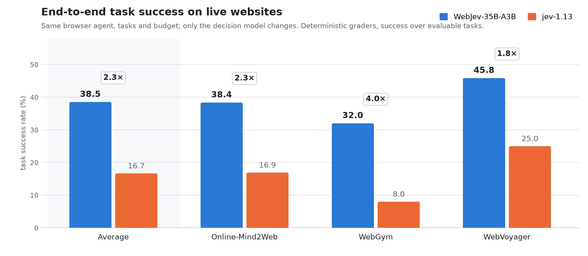
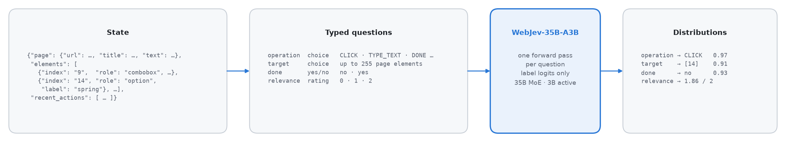

# WebJev-35B-A3B

**WebJev-35B-A3B is a decision model built to drive browser agents on real websites.**

At each step of a web task, WebJev reads the agent's view of the page and makes the step's two decisions:

- which action to take next;
- which of up to 255 on-page elements to take it on.

The page view is its URL, its visible text, its actionable elements and the recent actions.

WebJev is fine-tuned from Qwen3.5-35B-A3B-Base as a discriminative decision model: instead of generating text, it
learns to score the options of a question. Its training combines two sources:

- tens of thousands of execution-verified decisions that browser agents made on live websites;
- a broad mixture of typed decisions: classification, routing, tool choice, policy and evidence checking, and
  knowledge-intensive multiple choice.

The result is precise element grounding on long, cluttered pages, reliable next-action choices and strong general
structured decisions. Each decision takes a single forward pass and returns a full probability distribution over the
options.

[**Code**](https://github.com/lexmount/WebJev) · [**Dataset**](https://huggingface.co/datasets/Lexmount/WebJev) ·
[**Training**](https://github.com/lexmount/WebJev/tree/main/train)



## Highlights

- **Next-action prediction and element grounding.** WebJev decides directly from the agent's page state:
  - the action: click, type, select, scroll, wait, submit, dismiss, go back, finish or give up;
  - the element to act on, among up to 255 candidates on long real-world pages.

  It learns both from execution-verified decisions on live websites
  ([Lexmount/WebJev](https://huggingface.co/datasets/Lexmount/WebJev)).
- **Stronger agents on the live web.** In the same browser agent, with the same tasks and budget, WebJev completes
  **38.5%** of 125 live-website tasks. jev-1.13 completes **16.7%**, so WebJev solves **2.3×** as many. It leads on
  all three task collections, with four times the success rate on WebGym.
- **General structured decisions.** WebJev leads jev-1.13 on JevBench public (87.9 against 85.7) and on multi-class
  classification (86.3 against 83.3). It is ahead on Nimble evidence checking and customer-ticket triage too.
- **Fast and exact.** Each decision is one forward pass with no decoding: a web-page decision takes about a third of a
  second on one A100. The answer is always one of the listed options.

## Model overview

WebJev scores the options of each question about a state. It never generates free text, so there is no output
parsing and no answer outside the options you list.

| | |
|---|---|
| Developed by | Lexmount |
| Model type | decision model (option scoring at an answer position), sparse mixture of experts |
| Base model | [Qwen/Qwen3.5-35B-A3B-Base](https://huggingface.co/Qwen/Qwen3.5-35B-A3B-Base) |
| Parameters | 34.66B in total, about 3B active per token |
| Weights | BF16, 15 safetensors shards, 69.3 GB |
| Context | trained on inputs of up to 16,384 tokens |
| Options per question | 2–255 |
| Inference | `transformers`, vLLM |
| Languages | English instructions; English and Chinese web pages |
| Code | [github.com/lexmount/WebJev](https://github.com/lexmount/WebJev) |
| Training data | [Lexmount/WebJev](https://huggingface.co/datasets/Lexmount/WebJev) |
| License | Apache-2.0 (see [License](#license)) |



## [Evaluation](https://github.com/lexmount/WebJev/tree/main/evaluation)

All numbers are measured with the released BF16 weights served by vLLM, at temperature 1.0. The jev-1.13 numbers were
measured through its official API on the same inputs.

### End-to-end web tasks

WebJev serves as the decision component of the same browser agent on 125 real-website tasks: 75 from Online-Mind2Web,
26 from WebGym and 24 from WebVoyager. Each run has a budget of 900 seconds and 60 actions. A deterministic grader
checks the final page state and answer.

Success rate = solved ÷ evaluable tasks; tasks lost to browser infrastructure or grader errors are excluded.

| Task set | jev-1.13 | **WebJev-35B-A3B** |
|---|---:|---:|
| All tasks | 16.67% (20/120) | **38.52% (47/122)** |
| Online-Mind2Web | 16.90% (12/71) | **38.36% (28/73)** |
| WebGym | 8.00% (2/25) | **32.00% (8/25)** |
| WebVoyager | 25.00% (6/24) | **45.83% (11/24)** |

### General structured decisions

Eight benchmarks of structured decisions, beyond the web. Each item gives a state and a set of candidate answers, and
the model's choice is correct when it equals the reference label. The table reports accuracy.

| Benchmark (items) | What it measures | jev-1.13 | **WebJev-35B-A3B** |
|---|---|---:|---:|
| JevBench public (231) | general structured decisions (intent, extraction, tool choice, policy); the hard tier has long policies, multi-hop, temporal and numeric reasoning, and trap items | 85.71 | **87.88** |
| Multi-class decisions, dev (1,468) | news topic, review sentiment and stars, 77-way banking intent, question and entity type, yes/no reading comprehension, entailment, policy rules | 83.31 | **86.31** |
| Customer-ticket triage (873) | routing queue, anger and priority of support tickets (partly Korean) | 74.91 | **76.29** |
| Nimble held-out (324) | fine-grained evidence checking with minimal pairs: one fact changes and the answer flips | 92.59 | **92.90** |
| SemIf external (252) | claim verification: supported, refuted or not enough evidence | **98.41** | 98.02 |
| Cross-task transfer, dev (764) | MMLU, Emotion, TweetEval, QNLI, PAWS, SciQ and programmatic policy-rule questions | **85.21** | 85.08 |
| Typed business decisions, test (2,000) | agent-trajectory stop and escalation, customer requests, invoice approval, security-alert severity; teacher labels | **74.05** | 73.90 |
| MMLU-Pro, 10 options (1,000) | college-level knowledge and reasoning across subjects | **83.40** | 69.40 |
| **Average (equal weights)** | | **84.70** | 83.72 |

### Speed

Measured on one NVIDIA A100 80GB with vLLM and BF16. Requests are sent one at a time; latency covers all questions
about one state.

| Workload | p50 | p95 |
|---|---:|---:|
| short state, one question (claim verification) | 72 ms | 84 ms |
| policy or knowledge question (JevBench, MMLU-Pro) | 145 ms | 150–300 ms |
| support ticket, three questions | 228 ms | 309 ms |
| web page state, one decision | 337 ms | 755 ms |

## How to use

### With `transformers`

The model needs a `transformers` version with Qwen3.5 MoE support (`qwen3_5_moe_text`, 5.15 or newer) and one GPU
with at least 80 GB of memory.

```python
import json, torch
from transformers import AutoTokenizer, AutoModelForCausalLM

repo = "Lexmount/WebJev-35B-A3B"
tok = AutoTokenizer.from_pretrained(repo)
model = AutoModelForCausalLM.from_pretrained(repo, dtype=torch.bfloat16, device_map="cuda").eval()

state = {"page": {"url": "https://www.spanishdict.com/", "title": "SpanishDictionary.com", "text": "…"},
         "elements": [{"index": "9", "role": "combobox", "label": "Translate Spanish or English", "value": "spring"},
                      {"index": "14", "role": "option", "label": "spring"}],
         "recent_actions": [{"action": "Translate Spanish or English", "kind": "fill", "text": "spring"}]}
options = ["CLICK", "TYPE_TEXT", "SCROLL_DOWN", "PRESS_ENTER", "DONE", "BLOCKED"]
prompt = ("Context:\n" + json.dumps(state, ensure_ascii=False) +
          "\n\nQuestion: Search SpanishDict for 'spring'. Which operation should the agent perform next?\nOptions:" +
          "".join(f"\n({chr(65 + i)}) {o}" for i, o in enumerate(options)) + "\nAnswer: (")

inputs = tok(prompt, return_tensors="pt", add_special_tokens=False).to(model.device)
with torch.no_grad():
    logits = model(**inputs).logits[0, -1]
label_ids = [tok.encode(chr(65 + i), add_special_tokens=False)[0] for i in range(len(options))]
probs = torch.softmax(logits[label_ids].float() / 1.0, -1)       # temperature from decider_config.json
print(dict(zip(options, probs.tolist())))
```

For questions with more than 10 options, labels continue as single tokens (`K` … `Z`, then `AA`, `AB`, …). Build
those prompts with `decider/prompt.py` from this repository, which renders every label as one token.

### With vLLM

Start a server that returns the logits of the allowed tokens:

```bash
vllm serve Lexmount/WebJev-35B-A3B --dtype bfloat16 --max-model-len 34816 \
    --logprobs-mode processed_logits --max-logprobs 256
```

Then score a prompt: one generated token, restricted to the option labels.

```python
import math, requests

ids = tok(prompt, add_special_tokens=False)["input_ids"]          # the prompt above, ending with "Answer: ("
out = requests.post("http://127.0.0.1:8000/v1/completions", json={
    "model": "Lexmount/WebJev-35B-A3B", "prompt": ids, "max_tokens": 1, "temperature": 1.0,
    "logprobs": len(options), "allowed_token_ids": label_ids, "return_tokens_as_token_ids": True}).json()
top = out["choices"][0]["logprobs"]["top_logprobs"][0]           # {"token_id:<id>": logit}
logits = [top[f"token_id:{i}"] for i in label_ids]
z = [math.exp(x - max(logits)) for x in logits]
print(dict(zip(options, [x / sum(z) for x in z])))
```

### With llama.cpp / GGUF — community contribution

Community GGUF conversions by [emoubarak](https://huggingface.co/emoubarak) are available in **Q4_K_M, Q6_K, and Q8_0**:

👉 [WebJev-35B-A3B-GGUF](https://huggingface.co/emoubarak/WebJev-35B-A3B-GGUF)

The repository includes a llama.cpp serving adapter that supports WebJev's decision prompt format and exposes a compatible `/v1/systemone` endpoint.

See the repository README for downloads, setup instructions, and contributor-reported evaluation results. Thanks to emoubarak for the conversion and llama.cpp integration!

## How it works

The input is `Context: {state}`, followed by the question, the lettered options `(A) … (B) …` and the answer position
`Answer: (`. At that position, the model's hidden state is projected onto the LM-head rows of the option labels only
and normalized with a softmax over the valid labels. The labels are never generated.

- **Several questions about one state** are scored as separate prompts that share the state as a prefix.
- **Option order** is part of the input. The model was trained with shuffled options, so it conditions on the
  candidates' content rather than their position.
- **Inference settings** are stored in `decider_config.json`: temperature 1.0, up to 255 options per question, state
  before question.

## Model architecture

| | |
|---|---|
| Architecture | `Qwen3_5MoeForCausalLM` (text model) |
| Layers | 40: 10 full-attention layers and 30 Gated DeltaNet linear-attention layers (one full-attention layer every four) |
| Hidden size | 2,048 |
| Full attention | 16 query heads, 2 key-value heads, head dimension 256, gated output |
| Linear attention | 16 key heads, 32 value heads, head dimension 128 |
| Experts | 256 routed experts per layer (8 active per token) and 1 shared expert, expert width 512 |
| Vocabulary | 248,320 tokens |
| Parameters | 34,660,610,688 in total, about 3B active per token |

## Training

- **Recipe, data mixture and scripts:** [github.com/lexmount/WebJev/tree/main/train](https://github.com/lexmount/WebJev/tree/main/train).
- **Web-agent decision data:** [Lexmount/WebJev](https://huggingface.co/datasets/Lexmount/WebJev).

## Intended uses

**Intended uses.**

- The decision component of browser agents: next-action prediction and element grounding.
- Typed decisions in software pipelines: routing, classification, extraction choices, policy and evidence checks.
  Each is a question with an explicit option list.

**Out of scope.**

- Free-form generation, chat and open-ended question answering.
- Decisions whose options are not listed in the input.

**Usage notes.**

- **Knowledge-intensive decisions.** WebJev decides from the state, so include the relevant facts in it.
- **Confidence.** Probabilities use temperature 1.0 and rank options reliably. To act on confidence thresholds, check
  calibration on your own labels.
- **Input and hardware.** Inputs of up to 16,384 tokens. One GPU with 80 GB of memory runs the BF16 weights.
- **Live websites** change over time, so end-to-end results on live tasks vary between runs.

## License

WebJev-35B-A3B is released under the [Apache License 2.0](LICENSE). You may download, use, fine-tune and redistribute
the weights, including for commercial use.

- The model is a fine-tuned derivative of Qwen3.5-35B-A3B-Base, released under the Apache License 2.0.
- The prompt builder in `decider/` derives from the open-source Decider package, under the same license.


## Citation

```bibtex
@misc{lexmount2026webjev,
  title        = {WebJev-35B-A3B: A One-Pass Decision Model for Web Agents},
  author       = {{Lexmount}},
  year         = {2026},
  howpublished = {\url{https://huggingface.co/Lexmount/WebJev-35B-A3B}},
  url          = {https://github.com/lexmount/WebJev}
}
```

## Contact

Lexmount, via the Lexmount organization on Hugging Face.
