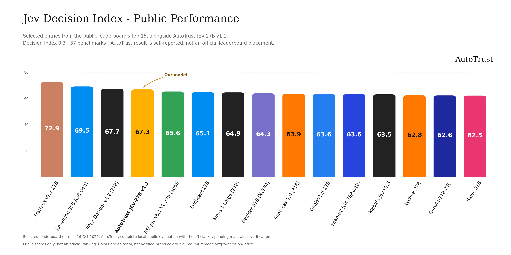
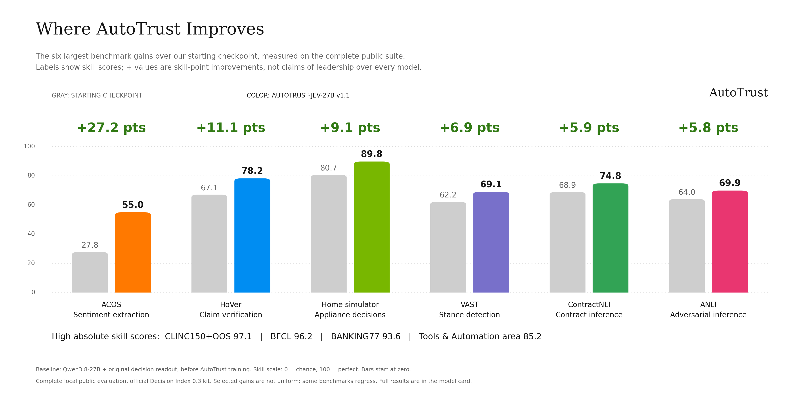

# AutoTrust-JEV-27B v1.1

**Structured decisions. Measured performance.**

AutoTrust-JEV-27B v1.1 is a text decision model that assigns probabilities to the answer options supplied with each question. This card reports its measured performance on the Decision Index 0.3 public suite.

**Public index: 67.31** | **37 indexed benchmarks** | **140,178 completed scoreable requests**

This is a complete local evaluation using the official evaluation kit, self-reported pending maintainer verification. No private or Full score is reported.

<p align="center">
  
</p>

## Benchmark highlights

The clearest strengths in this evaluation are **tool selection, intent classification, and everyday automation decisions**. Tools & Automation is the highest-scoring area at **85.19 skill points**.

| Capability | Benchmark | This Model |
| --- | --- | ---: |
| Intent classification, including out-of-scope detection | CLINC150+OOS | **97.06** |
| Tool selection | BFCL | **96.25** |
| Banking intent classification | BANKING77 | **93.63** |
| Appliance-control decisions | Home appliance simulator | **89.77** |
| API-use decisions | API-Bank | **87.36** |
| Claim verification | HoVer | **78.24** |
| Clinical textual inference | NLI4CT | **75.56** |
| Contract inference | ContractNLI | **74.80** |

These are scores on the Decision Index task adaptations, not claims of perfect real-world reliability or general deployment readiness.

<p align="center">
  
</p>

## Scores by area

The **skill score** accounts for each task's chance level: zero represents chance-level performance and 100 represents perfect performance. The following numbers are copied from the official scorer's output. The public index is not a simple average of the rounded values in this table.

| Area | Indexed benchmarks | This Model |
| --- | ---: | ---: |
| Tools & Automation | 5 | **85.19** |
| Language Understanding | 9 | **73.38** |
| Retrieval & Classification | 6 | **66.97** |
| Knowledge & Reasoning | 11 | **55.16** |
| Arts & Human Taste | 6 | **51.08** |
| **Public index** | **37** | **67.31** |

The scorer also reports a **raw index of 75.62**. Raw index and skill index are different metrics and should not be interchanged.

## Full benchmark results

The tables compare **AutoTrust-JEV-27B v1.1**, **JEV-27B**, and **Jev 1.14** (`jev-1.14.0`). Each cell is the benchmark's task score multiplied by 100: accuracy, F1 or nDCG according to the task, not the chance-adjusted skill index. Higher is better. Bold marks the best available score in a directly comparable row.

Our column comes from the complete local evaluation; the two reference columns are the published lab results, not new runs performed by us. All three use the same pinned base public corpus. Additional task-specific protocols must also match: **GSM8K is not directly compared**, because our saved result and the published two-track result use different configurations. A dash means no verified like-for-like value, not zero.

### Knowledge & Reasoning

| Benchmark | This Model | JEV-27B | Jev 1.14 |
| --- | ---: | ---: | ---: |
| WinoGrande | **95.26** | 82.56 | 91.08 |
| GSM8K (different tracks; not compared) | 84.99 | - | - |
| BBH fixed-option tasks | 86.05 | 78.94 | **93.19** |
| CRUXEval | **85.44** | 73.68 | 74.74 |
| MMLU-Pro | 73.65 | 61.53 | **82.13** |
| CLadder | 81.02 | 70.50 | **88.58** |
| MuSR | 70.61 | 62.37 | **72.61** |
| GPQA Diamond | 54.59 | 44.90 | **75.51** |
| SATA-Bench | **37.88** | 33.64 | 27.88 |
| ChessBench | **21.20** | 16.50 | 16.88 |
| HLE | 16.57 | 6.99 | **19.36** |

### Language Understanding

| Benchmark | This Model | JEV-27B | Jev 1.14 |
| --- | ---: | ---: | ---: |
| HellaSwag | **98.22** | 92.49 | 94.34 |
| FinEntity | **94.47** | 83.35 | 87.68 |
| NLI4CT | **87.44** | 84.27 | 85.12 |
| ContractNLI | **82.58** | 75.04 | 70.76 |
| ANLI | **79.90** | 77.20 | 74.27 |
| VAST | **79.38** | 54.76 | 73.65 |
| RAGTruth response-level hallucination | **83.79** | 80.88 | 75.12 |
| iSarcasmEval | **65.87** | 41.98 | 53.27 |
| ACOS | **56.39** | 19.48 | 33.14 |

### Retrieval & Classification

| Benchmark | This Model | JEV-27B | Jev 1.14 |
| --- | ---: | ---: | ---: |
| CLINC150+OOS | **97.08** | 84.62 | 90.28 |
| BANKING77 | **93.71** | 74.20 | 79.94 |
| HoVer claim verification | **89.12** | 73.90 | 76.75 |
| PhishNChips phishing decisions | 72.00 | 61.90 | **83.75** |
| BRIGHT | **49.19** | 48.44 | 47.05 |
| Amazon ESCI | 52.11 | 54.56 | **57.18** |

### Tools & Automation

| Benchmark | This Model | JEV-27B | Jev 1.14 |
| --- | ---: | ---: | ---: |
| BFCL | **97.23** | 95.99 | 96.40 |
| Home appliance simulator | **89.77** | 52.27 | 45.45 |
| API-Bank | **87.60** | 82.87 | 86.61 |
| When2Call MCQ | **89.54** | 78.53 | 81.65 |
| ToolRet | **68.71** | 65.73 | 65.05 |

### Arts & Human Taste

| Benchmark | This Model | JEV-27B | Jev 1.14 |
| --- | ---: | ---: | ---: |
| BPoMP | **96.52** | 92.94 | 90.41 |
| New Yorker caption matching | **82.95** | 68.56 | 72.54 |
| POP909-CL | **61.98** | 39.45 | 15.96 |
| cfcolor | 64.84 | 64.14 | **65.04** |
| Humicroedit | **63.20** | 61.15 | 61.76 |
| Habermas Machine | 42.78 | 40.39 | **44.57** |

### Comparison sources

- Published results: [pinned Decision Index benchmark data](https://huggingface.co/spaces/multimodalart/jev-decision-index/blob/0ddf6758073eb77ae449a3541f57286d7f39d93f/data/index.json).
- Evaluation definitions: [pinned methodology](https://huggingface.co/spaces/multimodalart/jev-decision-index/blob/0ddf6758073eb77ae449a3541f57286d7f39d93f/data/methodology.json).
- Reference version: Jev 1.14 (`jev-1.14.0`), lab run dated 2026-10-14. Shared corpus SHA256: `b2b56d6fb636837ca469e689087bdbf373dda8de7638aa2da6793e6eda0792d5`.
- These are descriptive cross-run comparisons. Different serving stacks and hardware do not support direct latency comparisons.

## Interpreting the scores

- **Tool and intent decisions:** BFCL, CLINC150+OOS and BANKING77 are among the strongest individual results. The tool-selection adapters should not be interpreted as end-to-end autonomous-agent evaluations.
- **Language and verification:** HoVer, NLI4CT and ContractNLI show useful results on claim checking and textual inference within the evaluated task formats.
- **Reasoning:** BBH fixed-option tasks score **79.78**, CRUXEval **76.90**, and MMLU-Pro **70.36** skill points. These results concern option selection, not free-form answer generation.
- **Limitations:** HLE is close to chance, and ChessBench, humor preference and consensus ranking remain weak areas. These results do not establish a performance ceiling for those tasks.
- **Transfer:** Validate the model on representative application data before relying on its probabilities or decisions. This public evaluation alone does not establish probability calibration or suitability for high-stakes use.

## Evaluation conditions

| Item | Setting |
| --- | --- |
| Evaluation | Decision Index 0.3 public suite |
| Completion | `complete: true`; 140,178 completed scoreable requests |
| Benchmarks included in the index | 37, across five areas |
| Official evaluation kit | Commit `f5a6e4f` |
| Serving runtime | vLLM 0.31.0 |
| Local hardware | One NVIDIA B300 |
| Concurrency | One server, 16 concurrent clients |
| Reported output | Option probabilities; no generated chain of thought |
| Result status | Self-reported local result; pending maintainer verification |

### Local latency

The saved scorer output reports a median of **64.8 ms**, a mean of **178.8 ms**, and a p95 of **800.5 ms** per request. Requests can contain different numbers of questions. These are local concurrent-run timings, not standardized leaderboard hardware measurements or a latency guarantee for deployment.

### Reproducibility

Evaluation results, scores and benchmark summaries are archived in [the evaluation results dataset](https://huggingface.co/datasets/autotrust/jev-decision-index-results), under `runs/autotrust-jev-27b-v1.1`.

## Usage

The model is served with vLLM and queried through the decision engine shipped in this repository.

```bash
pip install vllm==0.31.0 transformers==5.17.0 "startlux-decide @ git+https://github.com/StartLuxLabs/StartLux-Decision@cb1d11f1ac9e9b43b95ef3a6468fa29b607c40fd"
hf download autotrust/AutoTrust-JEV-27B-v1.1 --local-dir AutoTrust-JEV-27B-v1.1
bash AutoTrust-JEV-27B-v1.1/serve_vllm.sh AutoTrust-JEV-27B-v1.1
```

`serve_vllm.sh` turns on the StartLux prefix-bidirectional plugin (`STARTLUX_PREFIX_BIDIR=1`), so the model reads the whole prompt bidirectionally as it was trained, and sets the flags the results depend on: no prefix caching, no chunked prefill, FlashAttention, processed log-probabilities (up to 255). On an 80 GB card, serve with `MAX_LEN=32768`.

The vLLM endpoint by itself is not a decision API. `jev_vllm_engine.py` renders each question in the model's prompt format (`jev_format.py`), requests one token restricted to the option codes, and turns the returned log-probabilities into option probabilities. With the Decision Index kit installed, run it as an engine:

```bash
PYTHONPATH=AutoTrust-JEV-27B-v1.1 python -m decision_index run --engine jev_vllm_engine:JevVllmEngine \
  --option model=AutoTrust-JEV-27B-v1.1 --option url=http://127.0.0.1:8090/v1 --out runs/autotrust-jev-27b-v1.1
```

Supported question types are choice and yes/no; inputs are text only.

## License

**Apache-2.0.** AutoTrust-JEV-27B-v1.1 is released under the Apache License 2.0 (see [LICENSE](LICENSE)). This repository contains the fine-tuned AutoTrust-JEV-27B-v1.1 model weights and its decision readout head. Existing upstream attribution and license notices are retained in `NOTICE.base` and `LICENSE.base-apache-2.0`.

This license statement applies to this model release; it does not change the licenses or usage restrictions of third-party datasets.

## ModelScope

AutoTrust Labs has an official homepage on ModelScope (魔搭社区, Alibaba's model community):

https://www.modelscope.ai/organization/AutoTrust-Labs

A ModelScope mirror for **AutoTrust-JEV-27B-v1.1** is not currently confirmed. The model-specific link will be added once that release is available there.
